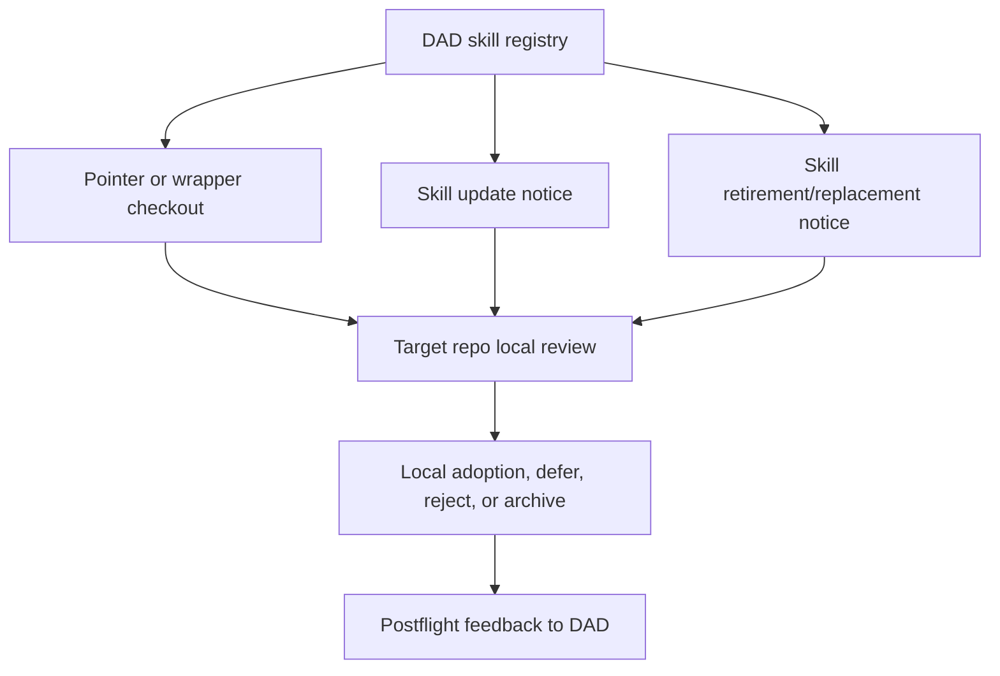

# Agent Skill Library

Status: governed DAD-side library for reusable agent skills, skill pointers,
skill lifecycle notices, and downstream checkout guidance.

## Purpose

DAD is the central library for agent skills that can help Codex, Claude Code,
Cursor, Copilot, and future agent environments. Other repos may "check out" a
skill by storing a small pointer or wrapper that names the DAD source, version,
return address, and update policy.

The checkout model is intentionally lightweight:

```text
DAD skill library
-> reviewed skill registry
-> downstream pointer or wrapper
-> repo-local approval and validation
-> DAD mail notices for updates, retirements, and replacements
```

The DAD registry is the lifecycle authority for DAD-managed skill metadata. A
target repo remains the authority for whether it adopts, updates, retires, or
replaces a checked-out skill.

## Core Surfaces

| Surface | Role |
| --- | --- |
| `registry/agent-skill-library.json` | Catalog of DAD skill records, lifecycle state, checkout modes, source paths, and update policy. |
| `schemas/agent-skill-library.schema.json` | Contract for the skill library registry. |
| `schemas/agent-skill-checkout-pointer.schema.json` | Contract for downstream skill checkout pointers rendered by DAD. |
| `assets/agent-skills/` | DAD-owned skill source directories. |
| `templates/downstream/AGENT_SKILL_POINTER.template.json` | Lightweight checkout pointer for repos that should not vendor skill content. |
| `templates/downstream/AGENT_SKILL_MANAGED_BLOCK.md` | Managed block for AI front doors or root agent files after local approval. |
| `templates/mail/skill-*.mail.template.json` | Candidate mail packets for skill checkout, update, retirement, and replacement notices. |
| `scripts/render_agent_skill_checkout.py` | Dry-run renderer for a pointer or wrapper from the registry. |
| `scripts/render_agent_skill_notice.py` | Dry-run renderer for skill checkout, update, and retirement mail notices from the registry. |
| `scripts/check_agent_skill_checkouts.py` | Dry-run checker for stale, retired, replaced, or unknown skill checkouts recorded in `processed/skills/checkouts.jsonl`. |
| `scripts/validate_agent_skill_library.py` | Registry, path, template, and mail-template validator. |

## Checkout Modes

| Mode | Use when | Boundary |
| --- | --- | --- |
| `pointer` | A repo only needs to know where the skill lives and when to check for updates. | Stores metadata only; no skill body is copied. |
| `wrapper` | A repo wants a tiny local `SKILL.md` that routes agents back to DAD. | Wrapper must state that DAD is source and local repo decides adoption. |
| `local_copy_requires_human_approval` | A repo must run offline or pin a full skill body. | Requires explicit human approval and provenance review. |
| `plugin_install_manual` | A skill is distributed through a plugin. | Human installs or upgrades the plugin; DAD only points to it. |

Default checkout is `pointer`. Renderers use public-safe `dad://` references by
default. Local filesystem paths are private/internal hints and require
`--include-local-paths`.

DAD must not silently write `.agents/skills/`,
`.codex/skills/`, `AGENTS.md`, `CLAUDE.md`, Cursor rules, plugins, hooks, or
source files in another repo.

## Lifecycle

Skill records use explicit lifecycle fields instead of inferred graph or score
changes:

- `active`: usable with its current applicability limits.
- `candidate`: available for experiment, not durable guidance.
- `deprecated`: still usable, but update or replacement is expected.
- `retired`: do not newly check out; existing checkouts should remove or pin
  with a local reason.
- `replaced`: use `replacement_skill_id` after local review.

When DAD updates, retires, or replaces a skill, it creates candidate mail. Mail
does not update the target repo. The target repo reviews the notice and decides
whether to change its local pointer or wrapper.

Each record is versioned by `version` and carries explicit lifecycle metadata:
supersession links, retirement reason, replacement ID, and notice templates.
The lesson graph ingests every registered record as a candidate `agent_skill`
node from `registry/agent-skill-library.json`; graph presence is not approval,
adoption, usefulness, or source truth.

The active central personal-source registrations are runtime-neutral
`generic_agent_skill` records: DAD Work Router, DAD Learning Loop, DAD Digital
Asset Radar, DAD Iteration Optimizer, DAD Agent Skill Forge, and Codex
Capability Radar. Their source directories are DAD-owned adaptations of
validated personal skill sources. The central contracts retain only portable
procedures and DAD gates; they do not install, modify, or configure a runtime.

DAD tracks known downstream checkouts in append-only generated state:

```text
processed/skills/checkouts.jsonl
```

Check which repos need update or retirement notices:

```text
python scripts/check_agent_skill_checkouts.py
```

```text
python scripts/render_agent_skill_notice.py --notice-kind update --skill-id skill:dad-coding-asset-control-plane --target-repo <repo-id>
python scripts/render_agent_skill_notice.py --notice-kind retirement --skill-id <skill-id> --target-repo <repo-id>
```

Lifecycle notice rendering is fail-closed: notices default to
`public_release_status=pending_human`, and retirement notices require the skill
to be marked `deprecated`, `retired`, or `replaced` in the registry.

## Relationship Graph



## Long-Running Commands

`skill:long-run-optimization-review-pack` provides the reviewed default for
commands that take at least 60 measured seconds or are expected to take at
least 120 seconds. A high-effort optimization director routes independent
algorithm, primary-source library/web research, and language/runtime reviews,
followed by a benchmark/parity plan and separate high-effort builder for an
approved bounded brief. The trigger is deduplicated by normalized command
signature per session so normal work does not create a subagent storm.

The runtime lane explicitly checks DAD's Rust library before proposing new
native code. Rust adoption still follows the profiled shadow-parity stages in
`assets/rust-buildout-guide/rust-buildout.json`.

## Material-Work Learning

`skill:material-work-learning-discovery` runs before postflight for every
material build or investigation. It checks the library first, then closes
learning loops and extracts privacy-safe candidate assets, asset-discovery
patterns, explicit conversation-only decisions, exceptional prompts, and
concrete reuse targets. Low-effort sentinels escalate only when the evidence is
uncertain or high leverage.

The conversation lane records only explicit participant rationale and the
delta absent from committed artifacts. It must not store raw transcripts,
hidden chain-of-thought, secrets, private payloads, or inferred private
reasoning.

## Global Personal Skills GPT

`skill:global-personal-skills-gpt` governs archival of explicitly allowlisted
personal global skills. It does not make the archive part of this library's
checkout source and does not change the live runtime source. The library stores
only the reviewed steward/adaptation metadata and pointer policy.

Archive bodies resolve to the local-only `personal_skill_archives` data surface
and are excluded from Git journal replication. Stable personal skill IDs,
content-specific revisions, shared blob hashes, DAD adaptations, portable
exports, checkout pointers, and runtimes remain distinct graph objects. The
`personal-skill-source:*` markers on existing runtime-neutral adaptations are
declared provenance for candidate `adapted_as` edges, not exact-copy claims.

Portable exports require named review and approval, omit runtime adapters by
default, contain no local absolute paths, and never install themselves. See
`docs/GLOBAL_PERSONAL_SKILLS_GPT.md`.

## Public And Private Boundary

## Subagent Continuous Improvement

`skill:subagent-continuous-improvement` applies after material subagent use. It
reuses DAD's immutable attempt/evaluation records, requires detailed self-review
and independent checking when available, and audits whether model family and
reasoning effort fit both the task and the material or dataset. Review is a
bidirectional peer mesh: workers may challenge incorrect checks, cheaper models
may catch bounded mistakes by frontier models, and no architect is exempt from
verification.

Routine feedback remains normal candidate evidence. Only concrete gate failures
or repeated calibrated patterns become exception candidates. Persistent issues
may produce a human-gated instruction-improvement proposal; no prompt edits or
reroutes apply automatically. The daemon is report-only; writing eligible
candidates to DAD's exception outbox requires the explicit
`asset-dir subagents improvement-review --record-exceptions` action. Super-high-risk unresolved architecture disputes
produce a privacy-safe manual copy/paste packet for Fable that presents all
sides, red-teams and premortems the options, and allows a non-binary solution.
The named human retains final authority.

Skill pointers can still leak sensitive context if they carry private source
paths, copied examples, or private repo descriptions. Cross-repo skill mail
therefore inherits `docs/MAIL_CENTER.md`:

- private, internal, restricted, or unknown source origins headed to a
  public-facing target are held for human release;
- skill mail is best-effort screened and candidate-only;
- payloads should contain short summaries, IDs, hashes, paths, and review notes,
  not raw copied code, secrets, private rows, or prompt blobs.

## Update Discipline

Other repos should check skill freshness through DAD mail or a scheduled digest,
not during every preflight. A repo-local preflight may warn that its skill digest
or mail digest is stale after 24 hours, but the central DAD job should be the
normal update path.

## No Scores

The skill library does not assign numeric value scores. Status, confidence, and
review posture are categorical lifecycle labels and must not be treated as proof
of usefulness.
