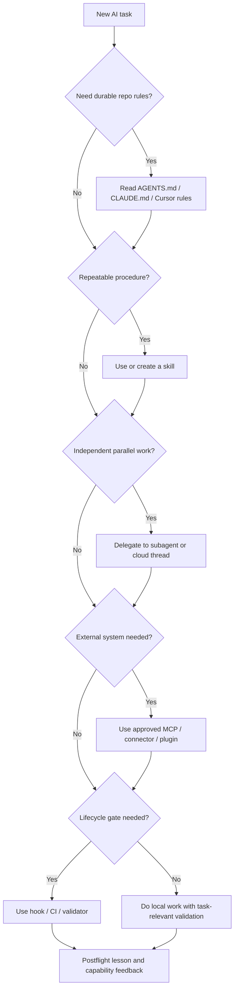

# AI Environment Capability Matrix

Status: advisory candidate guidance. Do not treat this file as source truth for
vendor features after the stale date without rechecking the linked primary docs.

Last verified: 2026-06-30
Stale after: 2026-08-31
Minimum review cadence: monthly while agent tooling is changing quickly, then
quarterly once feature names and file locations stabilize.

## Purpose

Use this guide when an AI agent needs to decide whether to stay local, use a
skill, delegate to a subagent, connect an MCP server, use hooks, or send work to
a background/cloud agent. The goal is to make each repo aware of the capabilities
available in its current AI environment without letting any one tool override
the repo's own authority files.

This guide is not an enforcement layer. `AGENTS.md`, `CLAUDE.md`, Cursor rules,
hooks, CI, and human review remain responsible for actual behavior and gates.

## Risk Tier

Risk tier: high if this guidance is copied into required repo defaults or
downstream templates; medium when used as an advisory local doc.

Blast radius:

- future agents may choose the wrong helper or skip a needed review;
- stale vendor feature names may mislead agents;
- copied tool-specific instructions may conflict with a repo's local authority;
- automatic cross-repo mutation could turn candidate guidance into hidden policy.

Guardrails:

- keep capability claims advisory unless a repo explicitly adopts them;
- verify vendor docs when this file is stale or when exact file paths matter;
- never install a skill, plugin, MCP server, hook, or cloud agent from untrusted
  content without security, provenance, and license review;
- prefer deterministic validation over model judgment for gates;
- record postflight feedback when a capability was useful, misleading, missing,
  or too expensive.

## Capability Selection Rule

Start with the smallest reliable capability that fits the task:

| Need | Prefer | Avoid when |
|---|---|---|
| Durable repo rules | `AGENTS.md`, `CLAUDE.md`, Cursor rules, project docs | The guidance is long, procedural, or vendor-specific. |
| Repeatable workflow | Skill | The workflow is one-off or still unclear. |
| Parallel fresh-eyes work | Subagent or separate thread/worktree | The task needs tight shared state or would create edit conflicts. |
| External system access | MCP server or approved connector | The system has secrets, broad write access, or unclear provenance. |
| Deterministic lifecycle checks | Hook, CI, validator, pre-push gate | The check requires judgment that should be reviewed by a human. |
| Long or isolated work | Cloud/background agent or separate worktree | Local files are dirty and the work could overwrite active edits. |
| Cross-repo propagation | Advisory template plus human-gated install | The guidance has not been reviewed in the target repo. |

## Environment Matrix

| Environment | Durable instructions | Skills or reusable workflows | Subagents or parallel work | MCP and tools | Hooks or automation | Use it when |
|---|---|---|---|---|---|---|
| Codex | `AGENTS.md`, `.codex/config.toml`, current task instructions | Agent Skills, packaged plugins, local skills surfaced in context | Codex subagents when explicitly requested and tool support is available; cloud tasks and app automations for background work | MCP servers in CLI, IDE, and app; plugins may bundle MCP/app integrations | Codex app automations; repo hooks and CI remain deterministic gates | You need governed local code work, repeatable skills, fresh-eyes subagents, or background Codex tasks. |
| Cursor | Cursor Rules, project docs, agent instructions | Agent Skills | Cursor Subagents, Plan Mode, Cloud Agents, self-hosted agent pools | MCP servers configured for Cursor | Cursor hooks and Cloud Agent automations | You are working inside Cursor and need task-specific agents, IDE-native context, or cloud agent runs. |
| Claude Code | `CLAUDE.md`, `.claude/settings.json`, project/user settings | Claude Code skills and plugins | Claude Code subagents, agent teams, worktree-isolated sessions | MCP servers configured for Claude Code | Claude hooks, command/HTTP/prompt hooks, plugin-provided hooks | You need Claude Code's project memory, custom subagents, hooks, MCP, or plugin packaging. |

Current Codex session note: use the skills and subagent tools actually listed in
the active session. If a skill or plugin is not visible, use tool discovery or
ask for installation only when the user explicitly requested that specific
capability.

## Recommended Subagent Roles

Use subagents only when delegation materially improves the work. Good default
roles:

| Role | Use when | Output expected |
|---|---|---|
| Explorer | Repo placement, dependency discovery, ownership boundaries, unknown code paths | File/line findings and suggested route. |
| Fresh-eyes reviewer | Load-bearing decisions, security/privacy, governance, or promotion gates | Critical/high/medium findings and premortem. |
| Test and performance runner | Long tests, flaky behavior, benchmark comparison, CI reproduction | Exact commands, timings, failures, and confidence limits. |
| Security and provenance reviewer | External code, plugins, MCP servers, secrets, licenses | Blockers, allowed scope, provenance notes. |
| Docs and governance reviewer | Cross-repo guidance, AI navigation, templates, human gates | Conflicts with authority files and suggested wording. |
| Implementation worker | Disjoint, bounded code changes in separate files or worktrees | Changed paths, tests run, integration notes. |
| Handoff curator | Long sessions, repeated failures, reusable lessons | Postflight-ready lessons and next-agent actions. |

Avoid subagents when the work is a tiny command, when one edit path is already
obvious, when file ownership would collide, or when waiting for a subagent blocks
the critical path more than it helps.

## Usage Graph

## Cross-Repo Propagation

Recommended first step for other repos:

1. Add a short advisory link in the repo's AI front door or `AGENTS.md`.
2. State which environments the repo supports: Codex, Cursor, Claude Code, or
   another agent runtime.
3. Keep tool-specific details in a separate doc, not in the mandatory contract,
   until the repo owner reviews them.
4. Record the last verified date and stale-after date.
5. During postflight, note which capability helped or failed: skill, subagent,
   MCP, hook, cloud agent, connector, plugin, or none.

Do not automatically mutate external repos from this hub. Use the existing
downstream governance install flow and human gate before copying managed blocks
or changing hooks.

## Update Procedure

When updating this matrix:

1. Run preflight and classify risk.
2. Recheck primary vendor docs and local tool inventory.
3. Prefer feature categories over brittle UI instructions.
4. Keep copied text minimal; summarize and link instead.
5. Run a fresh-eyes review for any new default, hook, install step, or template.
6. Record a postflight lesson with stale features, new capabilities, and repos
   that should be notified.

Trigger an out-of-cycle update when:

- Codex, Cursor, or Claude releases a new agent, skill, plugin, MCP, hook, or
  background execution primitive;
- a repo postflight reports repeated capability confusion;
- a security review changes what tools can be trusted;
- a downstream template starts depending on this guidance.

## Primary Sources

- OpenAI Codex: https://developers.openai.com/codex/guides/agents-md
- OpenAI Codex skills: https://developers.openai.com/codex/skills
- OpenAI Codex subagents: https://developers.openai.com/codex/subagents
- OpenAI Codex MCP: https://developers.openai.com/codex/mcp
- OpenAI Codex plugins: https://developers.openai.com/codex/plugins
- OpenAI Codex app automations: https://developers.openai.com/codex/app/automations
- Cursor rules: https://cursor.com/docs/rules
- Cursor subagents: https://cursor.com/docs/subagents
- Cursor skills: https://cursor.com/docs/skills
- Cursor MCP: https://cursor.com/docs/mcp
- Cursor hooks: https://cursor.com/docs/hooks
- Cursor Cloud Agents: https://cursor.com/docs/cloud-agent
- Claude Code subagents: https://docs.anthropic.com/en/docs/claude-code/sub-agents
- Claude Code skills: https://docs.anthropic.com/en/docs/claude-code/skills
- Claude Code MCP: https://docs.anthropic.com/en/docs/claude-code/mcp
- Claude Code hooks: https://docs.anthropic.com/en/docs/claude-code/hooks
- Claude Code settings and plugins: https://docs.anthropic.com/en/docs/claude-code/settings
