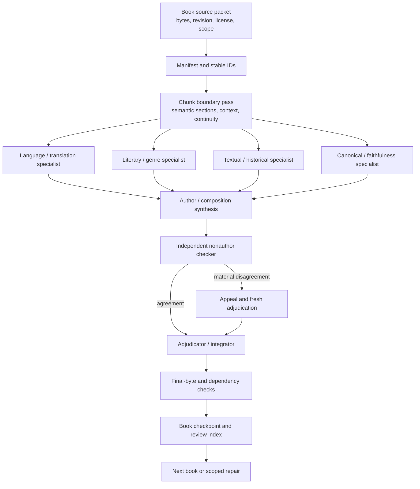

# DAD publication draft: Bible chunking review mesh

**Proposed DAD path:** `docs/BIBLE_CHUNKING_REVIEW_MESH.md`  
**Proposed navigation row:** `AI_TABLE_OF_CONTENTS.md` under `workflow`,
`agent_skill`, `knowledge_graph`, `validation`, and `public_safe`  
**Revision:** `0.1.0` (candidate architecture reference)  
**Status:** prepared for an isolated DAD pull request; not a production
qualification, canonical Bible decision, or activated DAD skill.

## Purpose

This document makes the M9 Bible-chunking method inspectable in Git. The
workflow description is reusable; the private Bible source files, full review
transcripts, local paths, and checkpoint payloads remain in the M9 workspace.
Git history is the change record: every workflow change should explain what
changed, why it changed, what evidence supported it, and which checks were
rerun.

## Authority and privacy boundary

- The selected Bible sources and their licenses remain authoritative in their
  source repositories. DAD metadata or generated chunks cannot override them.
- The M9 package is a 66-book Protestant candidate package. It remains local
  candidate work until its own acceptance gates are complete.
- WEB Classic is the separate English alignment witness. SBLGNT, MorphGNT,
  WLC/OSHB, and any other operational source keep separate version identities.
- DAD may retain reusable role contracts, method summaries, hashes, and review
  limits. It must not receive raw source rows, private paths, full transcripts,
  credentials, or copied proprietary text.

## End-to-end flow

The audit controller coordinates packets, records access and status, and
reopens final bytes. It does not become the primary author. Each specialist
freezes its own observations before seeing another specialist's proposal when
that independence matters. A checker receives the exact candidate plus the
acceptance contract and may reject it; it cannot silently rewrite it.

## Role and subject categories

Function and subject are separate fields. A role assignment is not an expertise
grade; competence remains attempt- and evidence-bound.

| Function category | Typical subject facet | Output |
| --- | --- | --- |
| author / composition | synthesis across the book | candidate chunk records and rationales |
| language / translation | Biblical Hebrew, Biblical Greek, morphology, discourse, WEB Classic alignment | source-relative wording, alignment notes, annotation gaps |
| literary / genre | narrative, poetry, wisdom, epistle, apocalypse, discourse | section boundaries and genre-sensitive context |
| textual / historical | witnesses, variants, historical setting | attested readings, contrary evidence, alternatives |
| canonical / faithfulness | 66-book scope, canonical placement, Scripture-faithfulness | scope and faithfulness checks; no invented doctrine |
| peer reviewer | one of the above domains | independent challenge and disagreement record |
| adjudicator / integrator | cross-domain synthesis | typed resolutions, appeals, dependency decisions |
| nonauthor quality checker | byte/schema/provenance and acceptance contract | pass, fail, or reopen decision |

Every attempt records the role, subject facet, instruction revision, source
packet identity, model/runtime tier, access actually observed, output hash,
independent check result, and unresolved limits. A separate quality review of
the subagent attempts checks instruction retention, category fit, source
coverage, contamination risk, and whether a claimed pass is only mechanical.

## Chunk contract

The chunk is a bounded review unit, not merely a token window. It carries:

1. stable book/chapter/verse or source-location identity and canonical book
   order metadata;
2. exact source revision and byte/Unicode provenance;
3. semantic section boundaries with intact surrounding context;
4. an English alignment reference to WEB Classic, kept separate from original
   language readings and annotations;
5. claims, alternatives, contrary evidence, appeals, holds, and typed
   dependencies;
6. annotation-gap statements when morphology or other annotations are absent;
7. source-supported rationale and a final-byte hash.

When the input is a scanned or exhibit-like document, a boundary may be an
exhibit even when the source uses another label. The record stores both the
source label and the semantic exhibit identity so that “Exhibit 1” cannot be
silently merged with “Exhibit 2.” OCR is an input concern; this workflow only
defines the file and boundary information required after extraction.

## Ordering and comparison

Work may begin with a whole-book pilot or a quality probe chosen for language,
genre, or boundary risk. That explains why observed completion order can differ
from Genesis-first canonical order. The deliverable is always rendered and
compared in the fixed 66-book canonical sequence, with stable IDs and explicit
source revisions. M7, M8, and M9 comparisons therefore join on book/chapter/
chunk identity and revision, never on the order in which workers happened to
finish.

## Acceptance and status

`draft` → `independent_review` → `adjudication` → `local_candidate` →
`book_accepted` is the local progression. Any failed or superseded candidate
stays retained with its reason and hash. `book_accepted` does not mean
production, scheduler, public release, or canonical promotion; those are later
gates owned by the source/consumer projects.

The minimum gates are exact source coverage, intact context, provenance and
Unicode checks, source-supported rationales, alternatives and appeals, typed
dependencies, independent domain review, nonauthor final-byte review, and a
read-back of the saved artifact. Unchanged completed checks are reused by their
input identity; changed source, instructions, runtime, schema, or boundary
rules reopen only the affected checks.

## Improvement loop

Each Git change to this workflow uses a small review packet:

- observed failure, surprise, or recurring friction;
- privacy-safe evidence and affected role/gate;
- proposed contract or sequencing change;
- compatibility impact on existing chunks and M7/M8 comparison;
- deterministic tests or replay evidence;
- independent review and explicit owner decision when shared DAD truth changes.

The workflow remains a candidate reference until DAD's own review promotes it.
No Git document, graph edge, score, or subagent output can authorize a source
change, a new provider, an API/MCP integration, or a production run.

## Proposed Git publication and maintenance

1. Add this document as `docs/BIBLE_CHUNKING_REVIEW_MESH.md` in an isolated
   branch based on the reviewed DAD remote tip.
2. Add one discoverability row to `AI_TABLE_OF_CONTENTS.md`; do not add private
   M9 paths or raw evidence to DAD registries.
3. Run the DAD documentation/navigation validators and the focused tests for
   the touched navigation surface.
4. Open a reviewable pull request. Keep merge and promotion separate from this
   preparation unless explicitly authorized.
5. Future changes use ordinary Git diffs and version history, with the M9
   private checkpoint hash cited in the review packet when needed.

## Known limits

This reference describes the observed M9 method and its controls. It does not
claim that every runtime enforces hidden-context isolation, that every source
has complete annotation coverage, or that any book is production-ready. Those
claims require fresh, scoped evidence.

## Revision history

| Revision | Change | Evidence/status |
| --- | --- | --- |
| `0.1.0` | Initial sanitized description of the M9 chunking mesh, role taxonomy, chunk contract, canonical-order comparison, and Git iteration loop. | Candidate; isolated PR and DAD review pending. |

