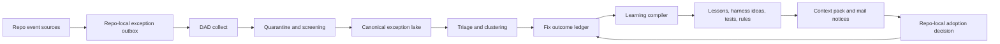

# DAD Exceptions Lake Buildout

Status: architecture buildout plan, candidate until reviewed.
Risk tier: high. This affects all repos, agent behavior, schemas, mail, learning
loops, and future control-plane defaults.

## Goal

DAD needs an exceptions lake that captures every important exception, failed
command, code change exception, review finding, rejected recommendation, bypass,
rollback, flaky test, governance violation, and fix outcome from enrolled repos.

The lake is not just an error log. It is a learning system:

1. capture the exception with provenance and safe context;
2. connect it to the change, repo, agent, asset, harness, and validation command;
3. record how it was fixed or why it was accepted;
4. mine repeated patterns into candidate lessons, tests, harnesses, non-negotiables,
   and DAD offerings;
5. route those lessons back to repos through pointer mail and context packs.

## Non-Negotiables

- Repos retain local source authority.
- DAD receives pointers, summaries, hashes, command metadata, and safe excerpts, not
  secrets, private rows, credentials, or large raw logs.
- Raw exception events are append-only.
- Fix knowledge is candidate evidence until reviewed.
- Private, restricted, internal, or unknown-origin exception records cannot flow into
  public-facing repos without the existing DAD human release gate.
- Scores are not allowed until a named methodology is written and validated.
- Human bypasses, protected repo events, and public-release holds are first-class
  exception types, not comments in a log.

## Never Collect

DAD must reject, quarantine, or leave in the source repo:

- credentials, tokens, cookies, private keys, session IDs, and secret-looking values;
- private rows, customer/client records, legal facts, medical facts, or row-level data;
- full stack traces or raw logs by default;
- prompt bodies, model hidden reasoning, pasted conversations, or tool transcripts;
- long source snippets, generated diffs, or complete files;
- local absolute paths destined for public-facing repos;
- payloads whose original source visibility is private, internal, restricted, or unknown
  when the target is public-facing and no human release exists;
- binary crash dumps, screenshots, database dumps, cache files, or dependency archives.

Allowed payloads are short metadata, IDs, hashes, command argv, exit code, duration,
redacted output references, path pointers, summary text, validation refs, and review
notes. Any exception event that needs more context should point back to the source repo
or a central-only quarantine record rather than copying the context.

## Architecture



The design mirrors the LawFirm OS exception-lake idea, but DAD's version is more
general: it handles software failures, AI-agent mistakes, governance exceptions,
public/private release holds, harness misses, and cross-repo learning.

## Event Sources

Each enrolled repo should emit exception packets from these sources:

- preflight: stale DAD, missing context, blocked gates, unavailable hub;
- midflight: failing command, retry, changed plan, user correction, rule ack,
  bypass request, sensitive payload block;
- tests and CI: pytest failures, cargo failures, lint failures, flaky retries,
  timeout, dependency install failure;
- runtime and CLI: uncaught exception, handled domain error, malformed input,
  lock timeout, stale report, stale cache;
- review: red-team finding, premortem failure story, security finding, false
  confidence, missing test, Claude/Fable/Codex disagreement;
- code change: rollback, hotfix, unexpected side effect, schema migration failure,
  generated file drift, roadmap gate mismatch;
- mail and enrollment: duplicate delivery, quarantine, human-release hold,
  protected repo write block, dirty worktree block;
- asset usage: DAD recommendation used, ignored, harmful, failed, or later upgraded.

Security/privacy capture uses a two-signal model. Signals that imply unsafe
content is present, such as `contains_secret_or_pii`, `contains_private_rows`,
`contains_raw_log_blob`, or `contains_prompt_injection_like_text`, suppress
outbound packets. Repos may separately emit safe block metadata when a local gate
fires:

- `sensitive_payload_blocked` with `credential_pii_screen_blocked`,
  `private_row_screen_blocked`, or `secret_screen_blocked` for
  `secret_or_pii_detected`;
- `raw_blob_screen_blocked` with `stack_trace_blocked`,
  `table_like_payload_blocked`, or `source_blob_blocked` for
  `raw_blob_rejected`;
- `prompt_injection_payload_blocked` with `data_prompt_injection_marker` or
  `untrusted_text_quarantined` for `prompt_injection_like_payload`.

Those packets carry only gate names, field classes, hashes, refs, source
visibility, and remediation paths. They must not quote the sensitive or
instruction-like content.

## Capture Completeness Contract

The lake cannot learn if repos only send memorable failures. Each enrolled repo needs a
small deterministic capture contract:

- `failed_command`: every AI-run command with non-zero exit, timeout, or tool error;
- `retry_or_plan_change`: a retry, workaround, changed approach, or user correction
  after a failure;
- `postflight_exception`: any test not run, validation gap, harmful recommendation,
  ignored required recommendation, or remaining risk;
- `ci_failure`: failed CI job, flaky retry, dependency install failure, or timeout;
- `governance_block`: protected repo write block, public-release hold, stale DAD,
  missing approval ID, dirty worktree block, or failed policy gate;
- `review_finding`: red-team, premortem, security, code-review, Fable, Claude, Codex,
  Cursor, or human finding with severity;
- `dad_recommendation_outcome`: harmful, failed, ignored, bypassed, or
  attempted-and-failed DAD recommendations, context-pack entries, assets,
  harnesses, skills, templates, mail advice, or saved-for-future recommendations
  whose later outcome matters;
- `fix_outcome`: the fix, accepted-risk decision, rollback, or duplicate decision
  that resolves or closes an event.

Four high-priority governance/freshness exceptions should not rely on agents
remembering to use direct records. They have deterministic capture signals:

- `protected_repo_write_block` for attempted protected-repo writes without
  explicit approval. Capture repo ID, attempted surface, approval state, block
  reason, and review ref, never file contents.
- `dirty_worktree_block` for blocked governance operations on active or unsafe
  worktrees. Capture branch ref, dirty-state summary, blocked operation, and
  next safe action, never diffs.
- `private_origin_public_target` for non-public-origin packets targeting
  public-facing repos without human release. Capture provenance and release
  status refs, never the private payload.
- `stale_report` for freshness failures. Capture report refs, input/methodology
  hash evidence, and regeneration command, never raw report bodies that may
  contain private output.

Capture can be lightweight. Repos do not need DAD Python internals for normal writes:
they can append JSONL, use a tiny helper, export a CI artifact, or let the DAD CLI
record events during preflight/midflight/postflight. Completeness is measured by
expected capture surfaces, not by raw volume.

## Repo-Local Capture

Normal recurring operation writes only inside the repo's mailbox/control surface:

```text
.digital-asset/exceptions/outbox.jsonl
.digital-asset/exceptions/inbox.jsonl
.digital-asset/exceptions/archive.jsonl
.digital-asset/exceptions/README.md
.digital-asset/exceptions/.gitignore
```

If a repo has not received the exceptions-lake enrollment surface yet, it can send
events through existing DAD mail using `message_type: governance_notice` or
`workflow_suggestion`, but the target state is a first-class exception packet.

Repo-local packets should be cheap to write. They do not run heavy Python test
suites and do not import DAD internals. A repo may append JSONL with a small helper,
a hook, an AI postflight command, or CI artifact export.

Source-side minimization happens before the packet leaves the repo:

- command output is omitted by default;
- output tails require an explicit local flag and must pass credential/PII screening;
- per-field length caps apply before DAD collection;
- raw stack traces become a short `error_fingerprint`, exception type, top frame path
  pointer, and output hash unless a human explicitly approves a richer central-only
  record;
- local paths are stored as repo-relative paths when possible;
- source repo visibility and return address are included on every packet.

The repo-local outbox is append-only. Archive records are acknowledgements and review
decisions, not destructive edits to the original event line.

## Live Specimen

The first real design specimen is a `LawFirm-os-intake` Fable 5 review issue that
identified a P0 budget-output expectation gap. The source repo wrote a candidate
DAD mail packet, DAD collected it as central mail, routed it as candidate-only
mail, then recorded a metadata-only exception event:

- collected DAD mail: `dad:mail:e347e567-3960-56e7-8db4-803ecffbf547`;
- original source mail: `dad:mail:ac201c5e-4f51-5fc2-ac9f-ddc7d45a79f1`;
- exception event:
  `dad:exception-event:lawfirm-os-intake-fable-budget-output-expectations-001`;
- event type: `review_finding`;
- issue classes: budget driver gap, budget math risk, authority-boundary risk,
  exception-lake mapping gap, learning-loop gap, UI authority risk, and test gap;
- boundary: observable context and decision logic only, no hidden chain-of-thought,
  no raw private payload, no silent learning, no source repo lake write.

This specimen demonstrates the intended path for complex review issues:

```text
repo-local structured review issue -> DAD mail collect -> DAD route ->
exception-lake candidate event -> future fix outcome / lesson candidate
```

The source repo may create candidate mail; DAD owns central exception-lake
classification and promotion gates.

## Canonical DAD Storage

DAD central storage:

```text
raw/exceptions/repo-events/YYYY-MM-DD/*.jsonl
processed/exceptions/quarantine/*.jsonl
processed/exceptions/lake/*.jsonl
processed/exceptions/fix-outcomes/*.jsonl
processed/exceptions/clusters/*.jsonl
processed/exceptions/review-queue/*.jsonl
processed/reports/exceptions_lake.md
processed/reports/exceptions_lake.json
```

Raw events are append-only. Processed records may be rebuilt from raw plus
registries. Review decisions are append-only and reference the raw event IDs.

Implemented contract surfaces:

- `schemas/exception-event.schema.json`
- `schemas/exception-fix-outcome.schema.json`
- `schemas/exception-backfill-review-decision.schema.json`
- `schemas/exception-event-type-registry.schema.json`
- `schemas/exception-learning-methodology.schema.json`
- `schemas/exception-capture-pattern-registry.schema.json`
- `schemas/exception-capture-scenarios.schema.json`
- `registry/exception-event-type-registry.json`
- `registry/exception-learning-methodology.json`
- `registry/exception-capture-pattern-registry.json`
- `assets/coding-harnesses/exception-capture-completeness/`
- `templates/downstream/EXCEPTIONS_README.md`

The CLI entrypoint is `asset-dir exceptions` with `paths`, `taxonomy`,
`capture-patterns`, `capture-suggest`, `capture-check`, `capture-audit`,
`record`, `collect`, `backfill`, `backfill-review-queue`,
`backfill-review-decision`, `backfill-review-decisions`,
`source-packet-requests`, and `report` commands.

## Packet Shape

Initial `ExceptionEventRecord` fields:

```json
{
  "event_id": "dad:exception-event:...",
  "schema_version": "0.1.0",
  "event_time": "2026-07-02T00:00:00+00:00",
  "source_repo": "repo-id-or-path",
  "source_visibility": "private|internal|restricted|public|unknown",
  "public_facing_source": false,
  "origin_chain": [],
  "return_address": "repo mailbox or central-only address",
  "agent": "codex|claude|cursor|human|ci|runtime",
  "model": "optional model name",
  "task": "short task summary",
  "stage": "preflight|midflight|postflight|ci|runtime|review|release|backfill",
  "event_type": "test_failure|runtime_exception|governance_block|review_finding|bypass|rollback|stale_artifact|harmful_recommendation|other",
  "taxonomy_dimensions": {
    "origin_surface": "command_runtime|test_validation|governance_control|...",
    "detection_mode": "command_exit_or_timeout|schema_or_report_validation|...",
    "impact_domain": "availability|correctness|security_privacy|...",
    "learning_route": "fix_outcome_link|harness_update|policy_or_governance_update|...",
    "default_handling": "direct_record_with_fix_outcome|manual_review|release_gate|...",
    "review_priority": "critical|high|medium|low|info"
  },
  "severity": "critical|high|medium|low|info",
  "status": "open|triaged|fixed|accepted|rejected|duplicate|archived",
  "context_refs": [],
  "capture_contract": "failed_command|retry_or_plan_change|postflight_exception|ci_failure|governance_block|review_finding|fix_outcome|dad_recommendation_outcome",
  "event_identity": {
    "identity_version": "exception-event-identity-v1",
    "identity_inputs": ["source_repo_id", "capture_contract", "stage", "event_type", "normalized_command", "normalized_path_refs", "error_fingerprint"],
    "collision_policy": "same identity but materially different context becomes duplicate_suspect and requires review"
  },
  "command": {
    "argv": [],
    "exit_code": 1,
    "duration_ms": 0,
    "redacted_output_ref": ""
  },
  "safe_summary": "short summary",
  "symptoms": [],
  "error_fingerprint": "",
  "suspected_cause": "",
  "fix_refs": [],
  "validation_refs": [],
  "asset_refs": [],
  "harness_refs": [],
  "trace_refs": [],
  "sensitivity": "public_safe|internal|private|restricted|unknown",
  "screening": {
    "credential_pii_screen": "pending|pass|blocked",
    "raw_blob_policy": "pass|blocked",
    "public_release_required": false,
    "human_release_id": ""
  },
  "dedupe_key": "stable normalized event key",
  "review_status": "candidate"
}
```

`ExceptionFixOutcomeRecord` rows live in
`processed/exceptions/fix-outcomes/outcomes.jsonl`. They are append-only
candidate metadata linked to one `event_id`; they do not rewrite exception
events. Reports join outcomes back to events by ID.

Current required fields:

```json
{
  "fix_id": "dad:exception-fix:...",
  "event_id": "dad:exception-event:...",
  "recorded_at": "2026-07-02T00:00:00+00:00",
  "source_repo": "repo-id",
  "source_visibility": "public|internal|private|restricted|unknown",
  "source_provenance": {},
  "recorded_by": "codex",
  "decision": "fixed|accepted_risk|deferred|duplicate|rejected|rollback",
  "summary": "short safe fix outcome",
  "validation_status": "validated|validation_missing|not_applicable|failed",
  "validation_refs": [],
  "regression_test_refs": [],
  "fix_refs": [],
  "asset_refs": [],
  "lesson_refs": [],
  "remaining_risks": [],
  "owner_authority": "repo-id or named human/local authority",
  "canonical_event_id": "",
  "canonical_event_lookup_status": "found_in_lake|missing_from_lake",
  "expiry": "",
  "event_lookup_status": "found_in_lake|missing_from_lake",
  "capture_contract": "fix_outcome",
  "dedupe_key": "stable normalized fix key",
  "screening": {},
  "review_status": "candidate"
}
```

Implementation policy:

- every fix outcome requires explicit `owner_authority`; DAD must not silently
  infer ownership from the source repo.
- `fixed` and `rollback` outcomes require at least one `validation_ref`, at
  least one `regression_test_ref`, and the linked `event_id` must already exist
  in the central lake.
- `accepted_risk` and `deferred` outcomes require an `expiry` or revisit marker.
- `duplicate` outcomes require `canonical_event_id`, and that canonical event
  must already exist in the central lake.
- `fixed` outcomes only count as validated when `validation_status=validated`,
  validation refs and regression-test refs are present, and
  `event_lookup_status=found_in_lake`.
- A missing event link is allowed as candidate metadata (`missing_from_lake`), but
  reports surface it separately and it cannot prove the original event was fixed,
  rolled back, or duplicated.

## Event Identity And Dedupe

`event_id` is stable when a repo intentionally records the same event again. The
default ID formula should use:

```text
stable_id(
  "exception-event",
  source_repo_id,
  capture_contract,
  stage,
  event_type,
  normalized_command_or_tool,
  normalized_path_refs,
  error_fingerprint,
  first_observed_date_bucket
)
```

`dedupe_key` is broader and may group repeated sightings. It must never be used to
silently merge records with different source visibility, different target visibility,
different human release state, or materially different affected assets.

Duplicate behavior:

- exact duplicate event ID -> acknowledgement count increments;
- same dedupe key, same source, same fingerprint -> repeated sighting;
- same dedupe key, different source repo -> candidate cluster member;
- same dedupe key, conflicting severity or fix status -> duplicate-suspect review;
- malformed or collision-suspect records go to quarantine, not the canonical lake.

## Fix Lifecycle

Allowed event status transitions:

```text
open -> triaged
open -> duplicate
open -> rejected
triaged -> fix_planned
triaged -> accepted_risk
triaged -> duplicate
fix_planned -> fixed_pending_validation
fixed_pending_validation -> fixed_validated
fixed_pending_validation -> reopened
accepted_risk -> reopened
fixed_validated -> regression_observed
regression_observed -> reopened
rejected -> reopened
duplicate -> reopened
* -> archived
```

Rules:

- only a fix outcome record can move an event to `fixed_pending_validation`;
- only validation evidence can move it to `fixed_validated`;
- `accepted_risk` requires rationale, owner, expiry/review date, and local authority;
- a duplicate must point to its canonical event;
- a reopened event preserves the old fix outcome as negative evidence;
- an archived event remains queryable and must not be deleted.

## Ingestion Flow

1. Repo writes a packet to `.digital-asset/exceptions/outbox.jsonl`.
2. DAD `exceptions collect` reads only reviewed repo policy entries.
3. DAD validates JSONL line-by-line. Malformed rows go to quarantine and good rows
   continue.
4. DAD verifies source-side minimization fields and rejects packets that include raw
   logs, long blobs, private rows, or output tails without explicit local approval.
5. DAD screens for secrets, PII, private rows, huge raw blobs, local path leakage,
   prompt injection, and public/private movement.
6. DAD canonicalizes repo ID, visibility, return address, origin chain, timestamps,
   and dedupe key.
7. DAD writes raw append-only records.
8. DAD routes safe events into the canonical lake or holds them in quarantine.
9. DAD clusters repeated events only by deterministic methods with methodology
   versions.
10. Fix outcomes are joined to events by event ID, commit/PR ref, command ref, or
   explicit postflight trace ID.
11. Learning compiler proposes candidate lessons, harness updates, tests, or
    non-negotiable changes.

## Learning Loop

The lake learns by separating raw facts from candidate interpretations.

Raw facts:

- event happened;
- repo and agent provenance;
- command metadata;
- status and timestamps;
- fix refs and validation refs;
- public/private screening results.

Candidate interpretations:

- root cause;
- repeated pattern;
- recommended future action;
- harness gap;
- non-negotiable candidate;
- DAD offering or skill update;
- repo-specific warning.

Learning products:

- candidate lessons in `raw/lessons/`;
- review feedback records through `lesson review-feedback`;
- harness candidates under `assets/coding-harnesses/`;
- preflight rule candidates;
- graph edges such as `gap_evidence_for`, `validated_by`, `depends_on`, and future
  exception-specific edges;
- context-pack warnings for repos likely to hit the same failure;
- upgrade mail to repos using or watching affected assets.

## Learning Compiler

The learning compiler runs after screened events and fix outcomes exist. It produces
candidate learning packets, never direct authority.

Inputs:

- exception events and fix outcomes;
- postflight trace outcomes;
- DAD recommendation outcomes;
- harness outcome records;
- usage ledger rows;
- review feedback records;
- graph edge registry and learning methodology registry.

Outputs:

- candidate lesson records with applies/does-not-apply/danger fields;
- candidate harness eval cases;
- candidate regression tests;
- candidate non-negotiable or preflight rule proposals;
- DAD offering calibration requests;
- graph edge candidates;
- repo-specific context-pack warnings;
- pointer-only mail notices.

Promotion gates:

- no global rule from a single event;
- no harness promotion without a failing case and a passing validation path;
- no preflight warning without reviewed repeated evidence and non-applicability notes;
- no public-facing notice from private/internal/restricted/unknown source without human
  release;
- no score, similarity, cluster confidence, or priority percentage without a named
  methodology and at least 10 reviewed samples for that family.

Implemented queue:

```text
asset-dir exceptions learning-queue
```

The queue joins the canonical event lake, fix outcomes, event-type taxonomy
dimensions, and methodology hashes. It writes:

- `processed/reports/exception_learning_queue.json`;
- `processed/reports/exception_learning_queue.md`.

Queue statuses are intentionally conservative:

- `validated_fix_review_candidate`: observed event type has validated fix evidence,
  no unresolved siblings, no unvalidated fix claims, no source-review blockers, no
  public-release blockers, and enough comparable events to enter human lesson review;
- `needs_fix_outcome`: observed event type has an unresolved event with no fix,
  accepted-risk, duplicate, rejection, or deferral record;
- `needs_fix_validation`: a fixed claim exists but lacks validated status,
  validation refs, or regression evidence;
- `needs_source_review`: backfill-only or mixed backfill path signals need source
  review and cannot promote learning;
- `needs_human_release`: non-public-origin evidence needs human release before
  public-facing reuse;
- `needs_more_evidence`: counts exist but are below the comparable-event threshold;
- `watch_only`: counts exist, but the evidence is not yet actionable.

The report shows counts and example IDs. It does not show confidence percentages,
does not read raw source content, and does not promote backfill-only, mixed-backfill,
unreleased non-public-origin, or under-threshold clusters into lessons, harnesses,
global rules, or repo instructions.

Implemented readiness harness:

```text
asset-dir exceptions learning-check --scenarios assets/coding-harnesses/exception-learning-readiness/examples/synthetic-learning-readiness-scenarios.json
```

The harness writes:

- `processed/reports/exception_learning_readiness_check.json`;
- `processed/reports/exception_learning_readiness_check.md`.

It creates temporary synthetic hubs and repos, records safe metadata-only
exception events and fix outcomes through the real DAD APIs, runs the learning
queue, and compares expected statuses and blockers. Current scenarios cover:

- clean public validated fix;
- mixed validated and unresolved evidence;
- schema-invalid legacy fix rows;
- unknown-origin release blocker;
- backfill-only source-review blocker.

This is synthetic generated evidence only. It prevents known false-green learning
states from returning, but it does not prove real repo completeness or promote a
lesson.

## Self-Learning Rules

DAD should promote a pattern only when enough reviewed evidence exists.

Early rules:

- one critical exception can create a high-priority review queue item, not a global
  rule;
- repeated exception type across two repos can create a candidate harness or test;
- repeated exception type across three independent contexts can create a candidate
  preflight warning;
- a harmful DAD recommendation creates an immediate calibration review for that
  offering;
- a fixed exception without validation stays open;
- an accepted exception must record why accepting it is safer than fixing it;
- a bypass without a reason is invalid;
- a public-facing target with private-origin context is held until human release.

Independence rules:

- repeated events from the same repo count as one context unless separated by a
  reviewed regression/fix cycle;
- events caused by the same DAD bug, same harness, same dependency outage, or same CI
  incident do not count as independent repo evidence;
- copied repos, renamed repos, and repo splits preserve lineage, so duplicate clones do
  not inflate counts;
- flaky tests are tracked separately until stability evidence proves a real product
  failure pattern;
- agent mistakes count by observable failure class, not by model blame.

No percentages should be shown until the sample size is at least 10 reviewed events
for that event family. Before then, reports show counts and examples only.

## Proposed CLI

```text
asset-dir exceptions record --repo <repo> --type <type> --summary <text> ...
asset-dir exceptions collect --repo all|<repo>
asset-dir exceptions screen --event-id <id>|--all-pending
asset-dir exceptions triage --event-id <id> --decision fix|accept|defer|duplicate|reject
asset-dir exceptions fix --repo <repo> --event-id <id> --decision fixed \
  --summary <text> --validation-ref <cmd-or-report> --regression-test-ref <test>
asset-dir exceptions cluster --method <method-id>
asset-dir exceptions learn --event-id <id>|--cluster <id>
asset-dir exceptions digest --repo <repo>
asset-dir exceptions report
asset-dir exceptions learning-queue
asset-dir exceptions learning-check --scenarios <path>
```

Repo agents should normally use `record` during postflight or after a failing
midflight. CI can write JSONL directly if the repo has only a lightweight footprint.

## Policy And Governance

Add reviewed config parallel to `mail.repos` and `enrollment.repos`:

```yaml
exceptions:
  repos:
    - id: dad
      path: .
      alias: dad
      visibility: private
      public_facing: false
      exceptions_enabled: true
      collect_allowed: true
      capture_audit_allowed: true
      backfill_allowed: true
      write_protected: false
```

Default policy:

- `--repo all` for exception collection or capture audit only uses reviewed
  `exceptions.repos`, not `mail.repos`.
- Discovered repos can be reported but not collected from until reviewed.
- Protected repos can be central-only.
- Public repos receive public-safe pointers by default.
- DAD never writes source code fixes into other repos as part of exception handling.

## Backpressure, Retention, And Noise Control

Without backpressure, the lake will drown in repeated failures.

- Per repo, cap low-severity repeated sightings per day and roll overflow into a digest.
- Always preserve critical/high governance, security, public-release, and harmful DAD
  recommendation events.
- Suppress repeated noisy clusters from cross-repo mail until a human or reviewed
  methodology marks them actionable.
- Keep raw append-only metadata, but archive old low-severity duplicates into compact
  summaries with source hashes.
- Record retention class per event: `standard`, `security_sensitive`, `public_release`,
  `protected_repo`, `debug_noise`, or `training_candidate`.
- Reports must show collection coverage, quarantine count, duplicate count, stale open
  count, fixed-without-validation count, and learning-candidate count.

## Relationship To Mail

Exceptions are higher-signal than ordinary mail, but they should still use the same
transport philosophy:

- repo-local outbox for sending;
- DAD central collection and screening;
- pointer-only delivery;
- dedupe by stable event ID and dedupe key;
- local adoption decision by target repo.

Mail can carry exception-derived recommendations, but raw exception packets live in
the exceptions lake.

## Relationship To Harnesses

The exceptions lake should feed harnesses directly.

Examples:

- repeated pytest timeout events -> Python test orchestration harness update;
- Rust shadow parity mismatch -> Rust parity harness regression case;
- Claude/Codex review miss -> agent-instruction red-team harness case;
- public/private release hold -> provenance harness case;
- malformed JSONL event -> mail/enrollment safety harness case;
- harmful DAD recommendation -> recommendation calibration eval.

Every harness promotion should cite exception event IDs or fix outcome IDs when the
harness exists to prevent a known failure class.

## Relationship To Graph

New graph work should eventually add exception-aware nodes and edges:

- node types: `exception_event`, `exception_cluster`, `fix_outcome`, `regression_test`;
- join edges: `fixed_by`, `validated_by`, `caused_by`, `blocked_by_policy`,
  `observed_in`, `affects_asset`;
- inference edges: `same_failure_pattern_as`, `likely_prevented_by`,
  `gap_evidence_for`.

Inference edges require named methodology versions and reviewed thresholds.
No exception-aware graph edge may be generated until the edge type exists in
`registry/graph-edge-registry.json`, the event schema is validated, and the edge basis
is declared in an exception learning methodology. Failure-derived graph edges are
candidate evidence only.

## Rollout Roadmap

Wave 0: Architecture Review

- Review this buildout with Fable 5, Claude, and Codex.
- Compare against LawFirm OS exceptions lake runtime.
- Decide minimal event schema and public/private policy.
- Produce red-team and premortem before implementation.

Wave 1: Schemas And Registries

- Add `schemas/exception-event.schema.json`.
- Add `schemas/exception-fix-outcome.schema.json`.
- Add `registry/exception-event-type-registry.json`.
- Add `registry/exception-learning-methodology.json`.
- Add validation for duplicate event types, stale methodology reports, and public
  release gates.
- Add tests for schema conformance, event status transitions, required minimization
  fields, and duplicate event-type rejection.

Wave 2: Local Capture And Central Collection

- Add `.digital-asset/exceptions/` template.
- Add `asset-dir exceptions record`.
- Add `asset-dir exceptions collect`.
- Parse JSONL line-by-line with quarantine.
- Redact/screen before canonical lake write.
- Add tests for malformed JSONL quarantine, raw log rejection, source-side field caps,
  same-path duplicate handling, and reviewed repo allowlist enforcement.

Wave 2.5: Capture-Completeness Harness

- Build a synthetic cross-repo capture harness that checks whether repos emit candidate mail
  and exception packets for the things DAD wants, without Lowell having to notice the
  pattern in chat.
- Use the LawFirm-os-intake specimen as a golden missed-capture case:
  `dad:mail:ac201c5e-4f51-5fc2-ac9f-ddc7d45a79f1` should have been generated by
  deterministic repo-side capture logic when the agent created a reusable structured
  review-issue workflow with schema/model, CLI, tests, docs, candidate mail, and an
  exception-lake mapping gap.
- Add synthetic fixtures for every DAD pattern family:
  asset, harness, skill, template, workflow, architecture reference, governance map,
  data map, mail pattern, exception pattern, review finding, fix outcome, and
  learning-loop candidate.
- For each fixture, assert whether the source repo should emit:
  - ordinary DAD mail;
  - an exception event;
  - both mail and exception event;
  - only local adoption/usage feedback;
  - no DAD packet because it is duplicate, too private, routine, or out of scope.
- For every positive fixture, assert `expected.required_fields` as part of the
  capture contract. Packet class and message type are not enough; if DAD updates
  a pattern to require a new metadata field, the scenario and observed outbox
  check must fail until the repo emits that field.
- Required fields follow the `required_fields_pattern_update_contract`: at least
  one matching JSONL packet row must carry all required fields with usable
  metadata values. Blank placeholders or fields split across unrelated or partial
  rows do not count.
- Add pattern-update simulations: change `registry/dad-needs-registry.json`,
  `registry/dad-offerings-registry.json`, `registry/exception-event-type-registry.json`,
  or a downstream template requirement, then prove enrolled repos receive/update the
  capture rule and start emitting the new fields or packet class.
- Add a `dad_cli_unavailable` mail-pattern simulation. If an enrolled repo cannot
  run `asset-dir` on PATH, it should try the DAD source checkout entrypoint and
  then append metadata-only JSONL fallback mail; the issue should not remain
  trapped in chat until Lowell notices.
- Add regression cases for “repo already had old DAD enrollment but lacked the new
  capture surface” so DAD can distinguish expected historical misses from true
  current capture failures.
- Add negative tests that hidden chain-of-thought, raw private data, long logs, real
  case rows, secrets, and prompt-injection-looking text do not get sent even when a
  pattern matches.
- Add a coverage report that lists each synthetic pattern, expected packet, actual
  packet, missed reason, repo enrollment version, and required DAD update.
- Acceptance criterion: a future run over the LawFirm-os-intake review-issue scenario
  creates the candidate mail and exception-lake seed deterministically, with no human
  intervention beyond ordinary review.

Implemented starter harness:

- `registry/exception-capture-pattern-registry.json` defines deterministic capture
  rules for asset, harness, language-frontier, skill, template, workflow,
  architecture-reference, governance-map, data-map, mail-pattern,
  exception-pattern, review-finding, fix-outcome, and learning-loop-candidate
  families.
- `assets/coding-harnesses/exception-capture-completeness/examples/synthetic-capture-scenarios.json`
  includes one reviewed synthetic fixture for each required family, the
  LawFirm-os-intake missed-capture case, pattern-update simulations, and unsafe
  positive-match negative controls.
- The scenario set also includes operational exception fixtures for failed command,
  test failure, runtime exception, tool unavailable / `asset-dir` fallback, repo
  rename lineage, and repo split lineage. These are metadata-only: command argv,
  exit code, safe path/test refs, top-frame refs, tool names, stable repo IDs, and
  enrollment pointers, not raw logs or private rows.
- The operational fixture set now also covers formerly direct-record-only gaps:
  malformed JSONL quarantine, duplicate mail delivery acknowledgement, pytest
  performance hotspots, and missing validation commands. These have reviewed
  capture rules because they are common repo-agent failure surfaces where waiting
  for a human to remember a manual exception record would lose learning.
- `asset-dir exceptions capture-check --scenarios <file>` writes a methodology-hashed
  report under `processed/reports/exception_capture_completeness.*`.
- `asset-dir exceptions capture-suggest --signal <signal> ...` compiles
  observable repo-side signals into a candidate packet plan from the reviewed
  capture-pattern registry. It reports matched rules, packet classes, event
  types, mail message types, capture contracts, required fields, stale capture
  surface warnings, and blocked payload/signal reasons. This is the lightweight
  repo-agent decision helper: it does not prove the event happened, does not
  authorize source mutation or public release, and does not echo payload samples.
  Emitted packets should preserve pointer-safe suggestion provenance such as
  `suggestion_id`, `methodology_hash`, `matched_rule_ids`, and
  `update_required` in safe metadata or trace refs so later audits can
  distinguish "agent emitted because registry suggested this" from source truth.
- `asset-dir exceptions taxonomy-coverage --fail-on-unrouted --fail-on-missing-scenarios`
  writes `processed/reports/exception_taxonomy_coverage.*`. It maps every reviewed
  exception event type to direct record contracts, capture-rule routes, backfill
  path-signal routes, and synthetic scenarios. The report also includes
  `taxonomy_review_summary` and `category_route_summary` so reviewers can see
  which categories are capture-rule-backed, backfill-heavy, direct-record-only,
  or high/critical but still manual. These summaries are triage aids; they do
  not close the human gate or prove deterministic auto-detection.
- Capture, taxonomy, and observed-audit reports emit
  `phase6_machine_gate_evidence`, which names the Phase 6 roadmap gates
  supported by the run through
  `evidence_scope: machine_only_not_roadmap_gate_evidence` and
  `supports_human_gate_id`, while keeping `human_gate_satisfied` false. Capture
  and taxonomy evidence supports capture completeness, pattern-update
  simulation, all pattern-family coverage, sensitive-payload negative tests,
  LawFirm missed-capture regression, and taxonomy route coverage. The
  observed-audit report separately supports observed repo capture-audit coverage
  without pretending the human gate is closed. Observed-audit machine evidence
  fails closed while normal or strict capture gaps remain, and it only passes for
  a satisfied reviewed scope. An ad hoc clean scan is still useful review input,
  but it must not be treated as all-repo coverage.
- Positive synthetic cases compare required metadata fields from the capture
  registry, and observed fixture checks verify those fields are present in actual
  JSONL outbox rows. This prevents a false green where a repo emits
  `workflow_suggestion` but omits the new fields DAD needs after a pattern update.
- Each reviewed capture rule must be explicitly listed in at least one reviewed
  synthetic scenario through `covered_rule_ids`, and the evaluator compares those
  declared IDs against the rules actually matched by the scenario signals. This
  prevents a reviewed rule from being added to the registry without a harness
  case, and prevents broad signals from silently exercising a different rule than
  the scenario claims to cover.
- Observed checks require one matching packet row to contain all required fields
  with usable values, and they fail on best-effort credential/PII, raw blob, or
  prompt-injection-like payload issues.
- Named invariant: `taxonomy_route_coverage_boundary`. Every reviewed/learnable
  exception type must have at least one safe route. A direct-record contract is a
  valid manual emission route, but it is not deterministic detector coverage.
  Capture rules must have synthetic cases; backfill routes are path-signal
  candidates only.
- The starter harness now supports observed-emission checks against actual JSONL
  outbox files. The canonical scenario set includes a metadata-only observed
  LawFirm-style mail outbox and exception outbox fixture, and tests also generate a
  temp repo outbox through DAD helpers.
- Payload samples are screened by DAD's best-effort credential/PII policy and a small
  prompt-injection-like text detector before any packet class is considered emitted.
- Current limitation: this exercises synthetic rule coverage plus fixture/temporary
  observed outbox comparison. Later waves still need live repo exporters, enrollment
  refresh checks, and observed-vs-expected verification across actual enrolled repos.
- `assets/coding-harnesses/exception-capture-completeness/prompts/fable5-exception-capture-and-backfill-red-team.prompt.md`
  is the handoff prompt for Fable 5 to review this exact standard: would the repo
  have emitted the right packet without Lowell rescuing the miss from chat?

Backfill safety and classification:

- Historical `exceptions backfill` is path/name-signal-only. It does not read file
  contents for evidence, and every generated event remains candidate evidence.
- Readable path refs, non-DAD roots, and policy-block overrides require an
  exception-specific approval ID listed in reviewed
  `exceptions.repos[*].approved_approval_ids`. A random non-empty `--approval-id`
  is not an approval.
- Backfill uses the reviewed classifier in
  `registry/exception-event-type-registry.json#backfill_classifier`, not hidden
  in agent memory. Rules are ordered, schema-validated, and include
  `classification_confidence`, `false_positive_risk`, `applies_when`, and
  `does_not_apply_when`.
- Runtime audit and backfill planning fail closed when a reviewed classifier rule
  lacks a rule ID, event type, or non-empty term list. Reviewed classifier terms
  take precedence over generic built-in audit terms when both match the same path
  signal, so provenance such as `backfill-rule:review-finding` is preserved.
- Current reviewed path-signal families include parity, slow tests, command
  timeouts, tool unavailable, environment config gaps, permission blocks,
  external service failures, data ingestion failures, identity conflicts, source
  authority conflicts, generated-code compile failures, build/packaging failures,
  synthetic fixture gaps, stale capture surfaces, graph/taxonomy drift, mail
  quarantine/backpressure, stale reports, artifact-registration drift,
  license/provenance review gaps, model-instruction drift, rollback,
  dependency-install, schema-validation, review-finding, premortem, CI-failure,
  and generic exception candidates.
- Every backfill event records `backfill-rule-id`, `backfill-classifier-ref`,
  `backfill-classifier-version`, and a repo-relative path hash. That provenance
  lets DAD re-run or invalidate old candidate classifications when the taxonomy
  changes.
- Readable repo-relative path refs are suppressed by default. Events store a
  `repo-relative-sha256` pointer and a `repo-relative-path-redacted:true` marker.
  `--include-path-refs` and non-DAD backfill roots require `--approval-id` at the
  CLI layer and should be used only for reviewed local/private runs.
- Backfill waves should be bounded with `--limit`, `--per-repo-limit`, and
  `--max-scanned-files`. The scanned-file ceiling prevents a "safe" historical
  pass from walking indefinitely when many repos are already at cap or only
  produce duplicate candidates.
- `asset-dir exceptions backfill-readiness --repo all` writes a central
  readiness matrix before any broad historical backfill wave. It summarizes
  reviewed repo policy, protected-repo blocks, approval requirements, capture
  surface freshness, observed path-signal counts, candidate signal summaries,
  and next actions. It is planning evidence only; it never approves or runs
  backfill.
- `asset-dir exceptions backfill-plan --repo all` turns readiness evidence into
  planning-only review waves: bounded-sample rescan, capture-surface refresh,
  capture-gap review, protected central-only review, policy enablement, approval
  review, metadata-only candidate backfill, and watch/no-signal. It still never
  writes target repos or runs backfill.
- `asset-dir exceptions capture-remediation-plan --repo all` turns the same
  readiness evidence into central-only remediation lanes. Its question is not
  "can DAD backfill yet?" but "what must be repaired so repo agents emit the
  right mail, exception, or fix-outcome packets without human rescue from chat?"
  Lanes include protected central-only review, capture-surface refresh,
  exhaustive rescan, emission review, classifier provenance refresh, policy or
  approval review, source-packet request planning, and watch/no-action. The
  report writes only DAD-side planning evidence under `processed/reports/`.
- `asset-dir exceptions capture-gap-review-queue --repo all` groups observed
  capture-audit path signals into stable review groups by repo, pattern family,
  suggested event type, source rule, expected review class, emission status, and
  matched capture rule. It keeps examples as path hashes plus safe metadata, not
  readable paths or raw source. This is the reviewer/source-repo work queue for
  deciding whether a grouped gap should become candidate mail, an exception
  event, a source-packet request, or an explicit no-packet decision.
- The wave plan also emits cross-cutting `proof_backlogs`:
  `capture_surface_refresh_backlog`, `exhaustive_audit_backlog`,
  `emission_review_backlog`, `classifier_refresh_backlog`, and
  `ready_for_source_packet_request`. A repo can appear in one of these backlogs
  even when its primary wave is protected or policy-blocked. This prevents
  governance status from hiding missing capture proof.
  `classifier_refresh_backlog` is only for missing or stale backfill classifier
  provenance in existing review evidence; a current classifier-backed path signal
  by itself is not a refresh blocker.
- Readiness fails closed when path-signal scans are truncated, capture surfaces
  are stale or unknown, or emissions are missing, unverified, or uncorrelated.
  Those repos are not `ready_now`; they must clear the appropriate review wave
  first.
- Candidate signal summaries group path-name-only findings by pattern family,
  suggested event type, source rule ID, matched term, expected-review class, and
  emission status. They help choose review waves and spot taxonomy drift. They
  are not event counts and do not prove an exception occurred.
- If any repo scan reaches its candidate limit, the summary is labeled as a
  bounded first-N sample and records `truncated_repo_count` plus
  `omitted_signal_count_unknown:true`. These bounded counts are review-routing
  hints, not complete distributions.
- Use `--candidate-limit 0` for an exhaustive metadata-only path-signal scan
  when a reviewed scope needs stronger evidence that historical patterns were
  not missed. Exhaustive mode still reads only repo-local outbox JSONL metadata
  and path names, keeps private/unknown repo paths hash-only, and does not
  approve source reads, repo writes, or backfill. It still has a scanned-file
  ceiling through `--max-scanned-files` so broad repo-family runs stop with an
  auditable `max_scanned_files_reached` reason instead of walking forever.
- `candidate_path_signal_summary.by_source_rule_id` links reviewed
  backfill-classifier rules such as `backfill-rule:tool-unavailable` to the
  path signals they produced. Built-in audit-only path terms use
  `<builtin_path_term>` until promoted into reviewed registry rules.
- `asset-dir exceptions backfill-review-queue` groups already-created
  path-signal backfill candidates by source repo, event type, and classifier
  rule. This is the safe handoff from historical scan output to human/source
  review. Each group records candidate counts, source visibility counts,
  taxonomy dimensions, classifier versions, path hashes, example event IDs,
  release-gate blockers, and the next source-review action.
- Backfill review groups are not promotion evidence. They are explicitly blocked
  from learning until a source repo or human confirms the candidate and, when
  needed, records an observed exception or fix outcome. Readable path refs are
  omitted by default from the queue even if a reviewed local/private backfill run
  stored them centrally. Re-emitting readable path refs requires a reviewed
  `--approval-id`.
- `asset-dir exceptions backfill-review-decision --review-group-id <id>
  --decision confirm|reject|needs_source_packet|needs_classifier_refresh|defer|archive`
  appends a review label to
  `processed/exceptions/review-queue/backfill_review_decisions.jsonl`. The ledger
  is append-only and candidate-only: a `confirm` label records source or human
  review of a path-signal group, but it still does not create an observed
  exception, fix outcome, lesson, DAD rule, public release, or source-repo
  mutation. Agent triage cannot confirm a readable-ref central-only group, and
  no group can be confirmed while classifier provenance is stale or missing.
  Human decisions require `--approval-id`; source-repo decisions require
  `--source-packet-id`. Idempotency is bound to the current queue fingerprint, so
  a changed group can receive a new append-only decision instead of being
  suppressed as a duplicate.
- `asset-dir exceptions backfill-review-decisions` summarizes the appended
  decision ledger by review group and decision type. This is audit and routing
  evidence only; promotion still requires the downstream exception/fix/lesson
  gates.
- `asset-dir exceptions source-packet-opportunities` reads the current backfill
  review queue plus the latest decision ledger and writes
  `processed/reports/exception_source_packet_opportunities.json` and `.md`. It
  shows which groups are blocked by classifier refresh, central readable-ref
  review, or a latest non-request decision, and which groups can safely receive a
  `needs_source_packet` decision. It is read-only planning evidence and does not
  append decisions, stage mail, deliver mail, confirm incidents, approve public
  release, or mutate source repos.
- `asset-dir exceptions source-packet-requests` compiles the latest
  `needs_source_packet` decisions into DAD-authored staged candidate mail at
  `processed/mail/staged/source_packet_requests.jsonl` plus
  `processed/reports/exception_source_packet_requests.json`. It does not deliver
  to target repo inboxes, does not sit under deliverable `processed/mail/outbox`,
  and does not mutate source repos. A later reviewed promotion/revalidation path
  must exist before staged requests can become deliverable mail.
- Source-packet request compilation rejoins every latest decision to the current
  backfill review queue and requires the queue fingerprint to match current
  generated evidence. Unknown groups, field mismatches, and stale fingerprints
  are quarantined instead of staged.
- If an older staged request is no longer backed by the latest
  `needs_source_packet` decision, DAD appends a staged `review_decision`
  cancellation row. It does not delete the original request, so the history stays
  append-only while future promotion code can see that the request is
  superseded.
- The exception learning-readiness harness includes a synthetic
  human-confirmed-backfill case. A human `confirm` decision is still only a
  label on path-signal evidence; the learning queue must remain
  `needs_source_review` until source packets or observed exception/fix evidence
  exist.
- Old, stale, or mixed backfill rows whose `backfill-classifier-version`
  provenance is missing or no longer matches the current reviewed classifier are
  queued as `needs_classifier_refresh`. They should be rerun or invalidated
  before source review so DAD does not review candidates under an unknown or
  outdated classifier contract.
- Some older backfill rows have enough immutable metadata to be reconciled
  without rewriting the lake: stored `backfill-rule-id`, `path-keyword`,
  `event_type`, severity, and capture contract must still match the current
  reviewed classifier. Reconciliation changes only generated queue/report
  routing fields such as `classifier_reconciliation_status`; it does not add a
  classifier version to historical lake rows and does not confirm an incident.
  Rows missing those metadata still fail closed as `needs_classifier_refresh`.
- `asset-dir exceptions backfill-refresh-plan` turns those blocked review groups
  into an explicit generated plan at
  `processed/reports/exception_backfill_classifier_refresh_plan.json` and
  `.md`. It separates unreconciled old groups that need bounded rerun or
  append-only invalidation from reconciled/current groups that may proceed to
  source-packet review. Path refs in the plan are hash-only by default, while
  source repo IDs are central/internal identifiers and not public-safe exports.
  The plan is candidate-only and does not rewrite the immutable lake.
- The generated review queue surfaces the latest backfill run's stopped reason
  and coverage warning, so bounded first-N backfill waves do not look complete
  unless the latest run actually exhausted the walk.
- Exception reports summarize event types, reviewed event categories, and
  taxonomy dimensions from
  `registry/exception-event-type-registry.json#taxonomy_dimensions`. The
  dimensions group exceptions by origin surface, detection mode, impact domain,
  learning route, default handling, and review priority. They are analytic triage
  labels only: they do not prove source truth, promote backfill candidates, or
  authorize cross-repo action.
- Exception reports also include `next_action_summary`, which separates
  current-classifier backfill candidates, stale or missing classifier
  provenance, public-release holds, unresolved observed events, and missing
  fix-outcome links.
- Exception event packets also carry their registry-derived
  `taxonomy_dimensions`. DAD overwrites repo-supplied dimensions during
  collection and validation compares lake rows back to the reviewed registry, so
  spoofed or stale classification labels cannot silently become source truth.

Observed repo audit add-on:

- `asset-dir exceptions capture-audit` reads repo-local mail outboxes, exception
  outboxes, and fix-outcome JSONL files without mutating the target repo.
- The audit also scans repo-relative path names for DAD-worthy capture signals such
  as postmortems, review findings, harnesses, skills, templates, architecture
  references, governance maps, data maps, workflows, and learning-loop artifacts.
  `--candidate-limit 0` runs this path-name pass exhaustively for the selected
  repos while preserving the same metadata-only and path-redaction boundaries.
- The report flags `missed_capture_candidate`, `pattern_gap_candidate`,
  `emission_unverified`, `mail_present_exception_gap_candidate`,
  `stale_capture_surface`, `capture_surface_version_unknown`, and
  `malformed_jsonl` for review. It also records
  `candidate_path_scan_truncated` when the bounded path scan hits its ceiling.
  Existing unrelated mail is not enough to prove capture worked; candidate
  signals are compared against matching message types, event types, and capture
  contracts.
- The report also writes aggregate and per-repo `candidate_path_signal_summary`
  blocks so reviewers can see whether a repo's historical candidates are mostly
  tool-unavailable, stale-report, review-finding, artifact-registration, or other
  taxonomy-backed signals before opening a backfill wave.
- Each observed-audit candidate path signal includes a nested
  `capture_suggestion` compiled from the reviewed capture-pattern registry. It
  carries matched capture rule IDs, candidate packet classes, event types, mail
  message types, capture contracts, required fields, and stale capture-surface
  state. This tells the source repo what packet it should consider emitting
  without claiming the path signal is a confirmed exception.
- `asset-dir exceptions capture-audit --strict --fail-on-gaps` also fails on
  `type_present_uncorrelated`, `emission_unverified`, stale capture surfaces,
  unknown capture surfaces, and truncated candidate scans. Use this in
  hardening runs, not as proof that every candidate path signal is a real
  exception.
- Private or unknown repo path signals are hash-only by default. Reviewed public
  or internal repos may include repo-relative path hints for local audit use.
- Acceptance criterion for this layer: running the observed audit over reviewed
  enrolled repos should catch the LawFirm-style missed-capture pattern without
  Lowell needing to notice it in chat, while old repos that predate the upgraded
  capture surface are labeled as stale/legacy instead of silently passing.

Central mail review add-on:

- `asset-dir mail central-review` records DAD hub triage for collected/routed
  central mail that was not delivered to a repo-local inbox.
- Central review writes `processed/mail/archive/central_review_decisions.jsonl`.
  It does not satisfy repo-local adoption, does not deliver mail, and does not
  replace `asset-dir mail release` for public-facing delivery gates.
- Pattern-update testing must cover every asset family DAD wants repos to send:
  assets, harnesses, skills, templates, workflows, architecture references,
  governance maps, data maps, mail patterns, exception patterns, review findings,
  fix outcomes, and learning-loop candidates. When DAD adds or changes a wanted
  pattern, synthetic fixtures and observed audits must prove repos receive the
  updated rule and emit the new packet or field after enrollment refresh.
- Mock Trial / Albert mail `dad:mail:4ea117b9-e308-5646-a364-78d411f7e3b0`
  added the `artifact_registration_drift` event class. This catches the false-green
  case where a governed artifact exists but is missing from hash/reproducibility
  manifests, suite/cadence validators, generated snapshots, AI front doors, TOCs,
  catalogs, or governance/data maps.

Wave 3: Fix Outcome Ledger

- Add `asset-dir exceptions fix`.
- Join postflight trace IDs, command results, commits, PRs, tests, and review
  findings to event IDs.
- Require validation refs before marking fixed.
- Add tests that fixed-without-validation remains open, accepted-risk requires owner
  and expiry, duplicate requires canonical event, and reopened preserves prior outcome.

Wave 4: Reports And Digest

- Add `asset-dir exceptions report`.
- Add repo digest of open, fixed, accepted, repeated, and stale events.
- Add context-pack warnings for relevant repeated exceptions.
- Add tests for low-severity backpressure, digest overflow, stale open counts, and
  public-safe report output.

Wave 5: Learning Compiler

- Generate candidate lessons, harness cases, test ideas, non-negotiable candidates,
  and DAD offering calibration requests.
- Keep all generated learning candidate-only until reviewed.
- Add tests for independence rules, N < 10 count-only reporting, harmful
  recommendation calibration, and no global rule from one event.

Wave 6: Cross-Repo Feedback Loop

- Send pointer-only notices to repos using or watching affected assets.
- Enforce weekly notice budgets.
- Track whether target repos implemented, saved for future, rejected, or reported
  the recommendation harmful.
- Add tests for private-to-public hold, human release approval, weekly notice budget,
  duplicate notice suppression, repo rename lineage, and repo split behavior.

Wave 7: Runtime Integrations

- Optional CI exporters for GitHub Actions.
- Optional Python logging handler.
- Optional Rust tracing subscriber.
- Optional MCP/tool wrapper that catches agent tool failures.
- Optional Cloudflare deployment only after local-first model is proven.

## Red-Team And Premortem

Likely failure story:

DAD starts collecting raw logs from many repos, one public repo receives a private
failure summary, a repeated flaky test is promoted as a global rule too early, and
agents begin obeying noisy exception-derived advice. Meanwhile, real root causes are
lost because fix records say "fixed" without validation.

Critical mitigations:

- raw output blocked by default;
- private-to-public human release gate;
- no score or cluster confidence without methodology;
- fixed requires validation refs;
- accepted requires explicit rationale;
- generated lessons remain candidate;
- event and fix schemas validated in CI;
- malformed records quarantined, not dropped silently;
- repo allowlist required for collection.

## Fable 5 Review Prompt

```text
You are reviewing DAD's proposed Exceptions Lake Buildout.

Goal: DAD should collect exception/failure/fix information from all enrolled repos,
learn from how failures were fixed, and route safe pointer-only recommendations back
to repos without leaking private information or overriding local source authority.

Please red-team and improve this design:

1. Where could this accidentally collect secrets, private rows, raw logs, prompt
   injection, or public-unsafe context?
2. Is the event schema enough to connect an exception to the repo, agent, command,
   DAD asset, harness, fix, validation, and future lesson?
3. How would you design the lake if you wanted it to become an exceptional learning
   engine rather than a graveyard of logs?
4. What should DAD learn deterministically, and what should require human review?
5. What should be borrowed from LawFirm OS exception-lake ideas, and what should DAD
   do better or differently?
6. What are the highest-leverage first schemas, commands, and tests?
7. How should DAD avoid false confidence from tiny sample sizes, duplicate failures,
   flaky tests, and noisy AI-agent mistakes?
8. What unique architecture would you propose if you were not constrained to a
   standard logging/observability design?

Return Critical, High, Medium, and Low findings, then a revised implementation order
with concrete schema and command suggestions. Do not implement changes.
```
