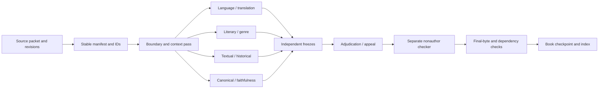

# M9 subagent role catalog and checker flow

This catalog exposes the reusable role structure without publishing source text, private task history, or hidden transcripts. Each role is saved with its exact instruction revision and input/output identities in the private M9 archive; this document describes the public contract.

## Two independent category axes

| Function | Biblical subject facet |
|---|---|
| Source reader and provenance checker | Hebrew, Greek, morphology, discourse, source metadata |
| Author/composition analyst | authorship and composition questions, with source-qualified limits |
| Language/translation specialist | Biblical Hebrew or Greek, morphology, discourse, WEB Classic alignment |
| Literary/genre specialist | narrative, poetry, wisdom, prophecy, epistle, apocalyptic, discourse form |
| Textual/historical specialist | textual variants, historical context, witness comparison |
| Canonical/faithfulness specialist | canon boundaries, theological claims, Scripture-faithfulness constraints |
| Peer reviewer | the same facet as the primary, with an independent freeze |
| Adjudicator/integrator | cross-role comparison after all relevant freezes |
| Independent nonauthor quality checker | structural, provenance, retention, scope, and qualification checks |

The function axis says what the worker does. The subject axis says what kind of biblical judgment it is allowed to make. A single worker can carry more than one subject facet only when the dispatch records that scope explicitly.

## End-to-end flow

The audit controller coordinates the mesh and does not become the primary author. Fresh source-only roles receive the exact admitted source packet and neutral method, not earlier proposals or root judgments. Post-freeze adjudicators may compare frozen role outputs. The nonauthor checker receives the candidate and its exact pins, writes only a check, and cannot edit the candidate.

## What every saved attempt records

- role ID and function/subject categories;
- instruction revision and method identity;
- exact source packet and source revisions;
- model/runtime tier and reasoning effort;
- actual access, unknown or unmeasured access, and isolation limits;
- output path, byte count, and SHA-256;
- independent-check identity and result;
- unresolved alternatives, contrary evidence, appeals, holds, and dependencies;
- qualification status and explicit limits.

The quality review checks instruction retention, category fit, source coverage, stable identities, semantic exhibit boundaries, annotation-gap preservation, contamination disclosures, and whether a mechanical pass has been overstated as semantic acceptance.

## Independence and improvement

The minimum independent path is primary freeze → independent peer freeze → adjudication → separate nonauthor check → final-byte reopen. Disagreement is preserved until a designated adjudicator resolves it with source-qualified reasons. If a checker or worker fails, the failure and causal correction are saved as a new attempt record; completed checks are reused when their inputs are unchanged.

The workflow is provider-neutral and can run as local deterministic work, with or without an API or MCP adapter. An adapter change is a new evidence boundary and does not rewrite the provider-neutral record.
